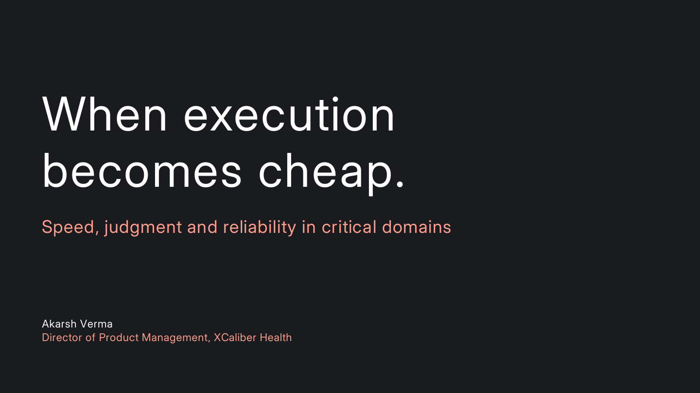

<!-- When execution becomes cheap. Speed, judgment and reliability in critical domains Akarsh Verma Director of Product Management, XCaliber Health -->

---

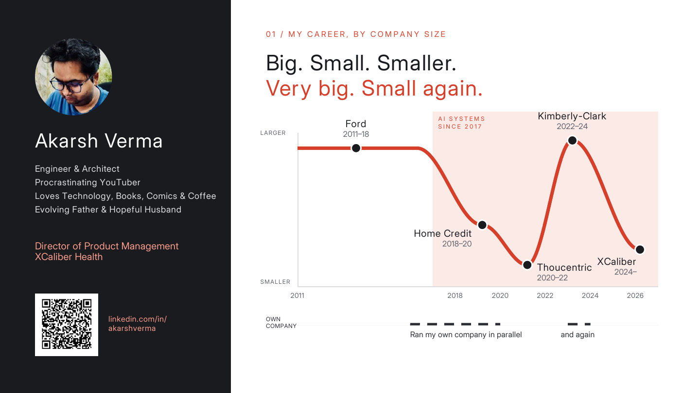

<!-- Akarsh Verma Engineer & Architect Procrastinating YouTuber Loves Technology, Books, Comics & Coffee Evolving Father & Hopeful Husband -->

---

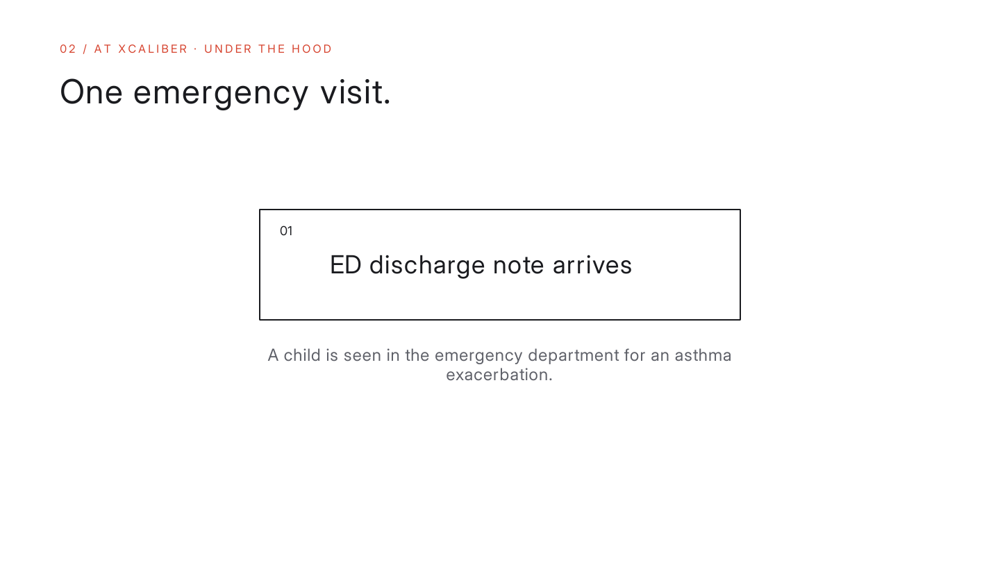

<!-- 02 / AT XCALIBER · UNDER THE HOOD One emergency visit. 01 ED discharge note arrives A child is seen in the emergency department for an asthma exacerbation. -->

---

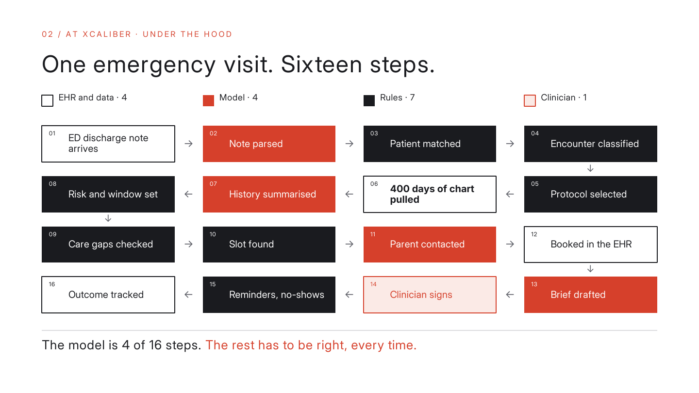

<!-- 02 / AT XCALIBER · UNDER THE HOOD One emergency visit. Sixteen steps. EHR and data · 4 Model · 4 Rules · 7 -->

---

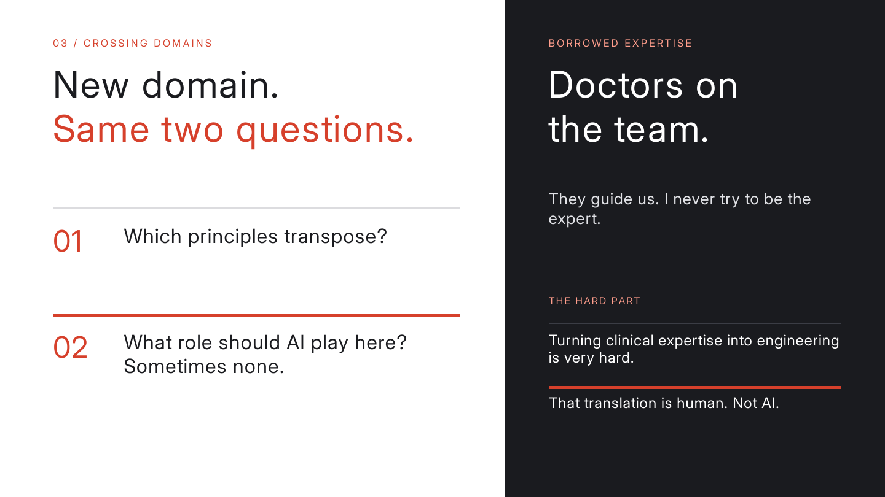

<!-- 03 / CROSSING DOMAINS New domain. Same two questions. 01 Which principles transpose? -->

---

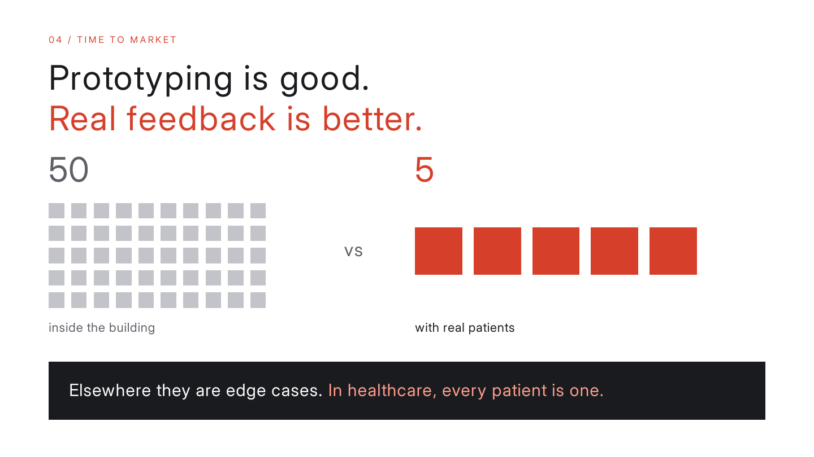

<!-- 04 / TIME TO MARKET Prototyping is good. Real feedback is better. 50 inside the building -->

---

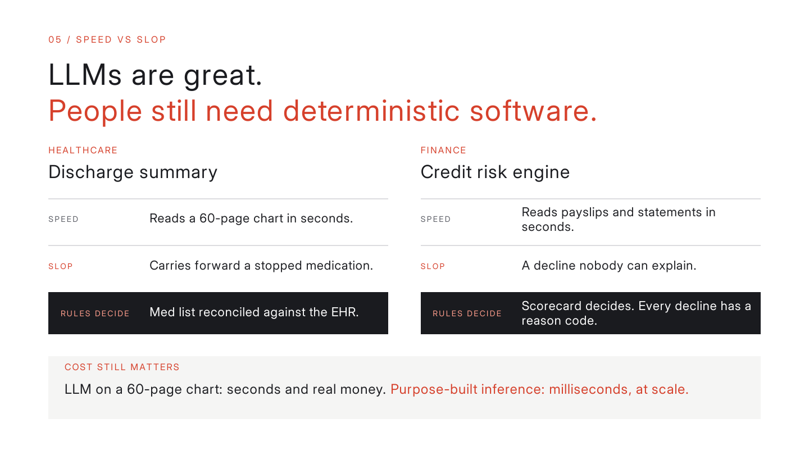

<!-- 05 / SPEED VS SLOP LLMs are great. People still need deterministic software. HEALTHCARE Discharge summary -->

---

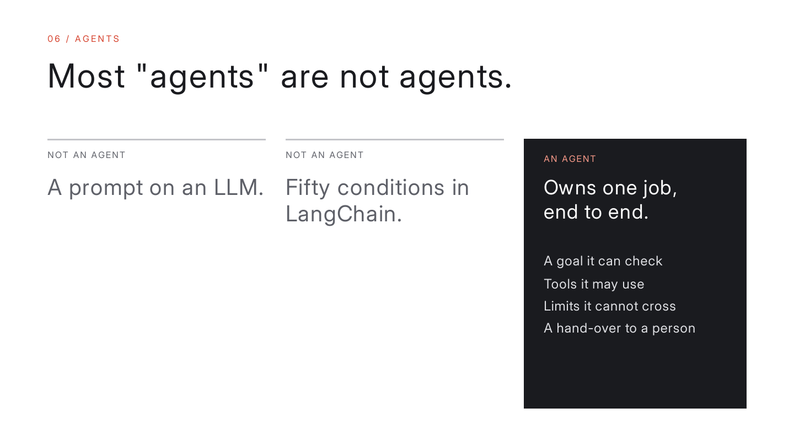

<!-- 06 / AGENTS Most "agents" are not agents. NOT AN AGENT A prompt on an LLM. NOT AN AGENT -->

---

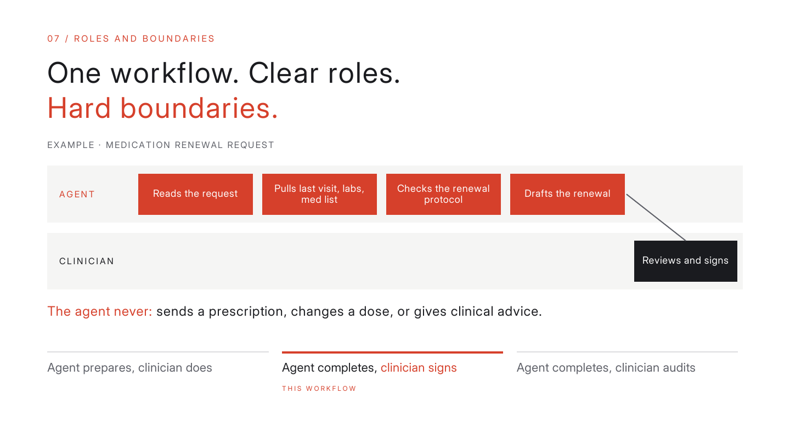

<!-- 07 / ROLES AND BOUNDARIES One workflow. Clear roles. Hard boundaries. EXAMPLE · MEDICATION RENEWAL REQUEST AGENT -->

---

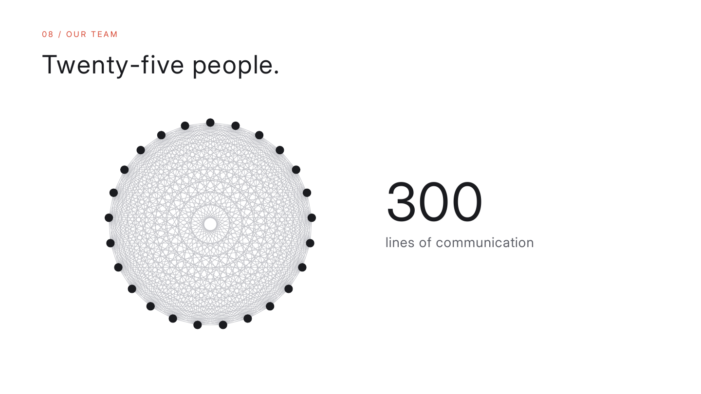

<!-- 08 / OUR TEAM Twenty-five people. 300 lines of communication -->

---

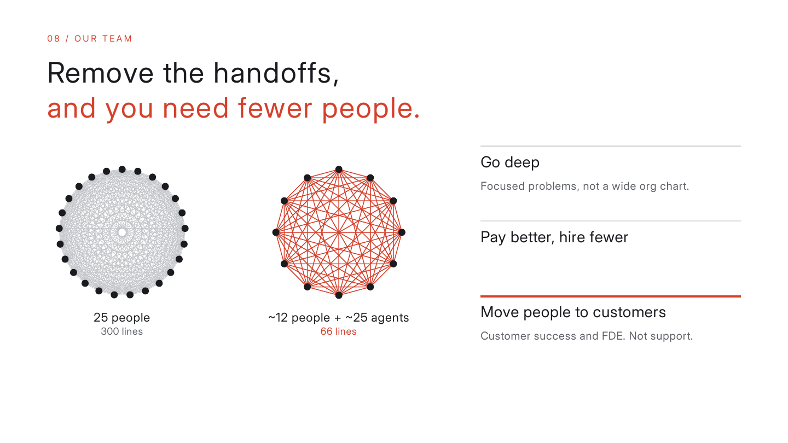

<!-- 08 / OUR TEAM Remove the handoffs, and you need fewer people. 25 people 300 lines -->

---

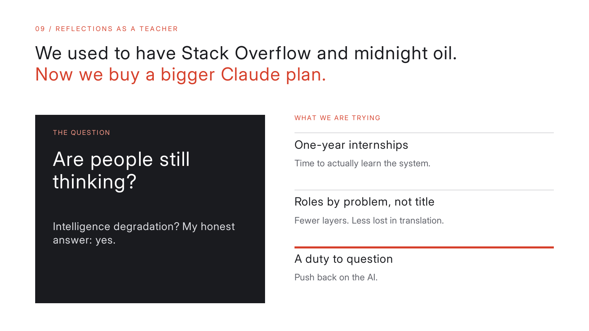

<!-- 09 / REFLECTIONS AS A TEACHER We used to have Stack Overflow and midnight oil. Now we buy a bigger Claude plan. THE QUESTION Are people still thinking? -->

---

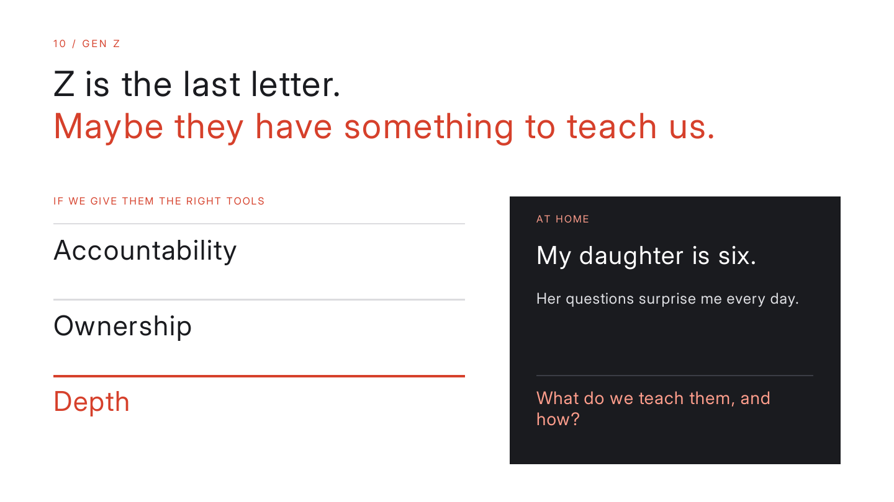

<!-- 10 / GEN Z Z is the last letter. Maybe they have something to teach us. IF WE GIVE THEM THE RIGHT TOOLS Accountability -->

---

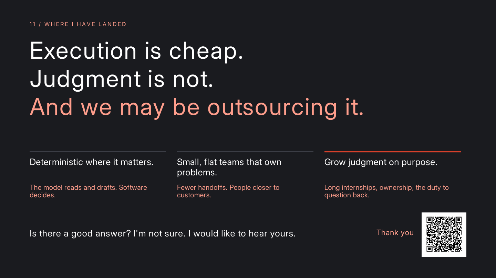

<!-- 11 / WHERE I HAVE LANDED Execution is cheap. Judgment is not. And we may be outsourcing it. Deterministic where it matters. -->
